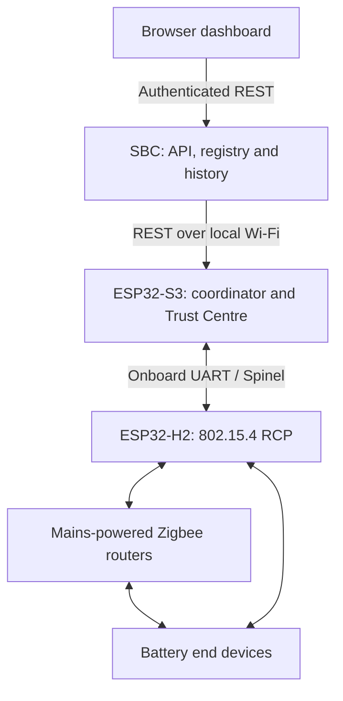

# Architecture

## Decision

Use the Espressif S3/H2 gateway board as a **Zigbee coordinator**, with an SBC as the application host. The name “Thread Border Router” describes the hardware's other intended use; this repository flashes Zigbee firmware and does not provide simultaneous Thread border routing.

| Component | Responsibility | Persistent state |
| --- | --- | --- |
| H2 | Radio/MAC, frame transmission and reception | RCP image; no application registry |
| S3 | Zigbee coordinator/Trust Centre, commissioning, discovery, ZCL, local API | SDK network/security state in NVS and a separate IEEE/NWK registry |
| SBC | Dashboard API, device projection, raw events and normalized values | SQLite database and polling cursor |
| Browser | Display and user controls | Token only in current page memory |

## Physical and RF design

S3 Wi-Fi and H2 802.15.4 use separate radios. This removes the single-C6 radio time-sharing bottleneck. Both still occupy 2.4 GHz: antenna coupling and nearby Wi-Fi can cause interference. Board PTA wiring is available, but this MVP does not enable or validate external coexistence. Choose channels and location deliberately; Ethernet support is a future firmware configuration, not enabled in this release.

The supplied S3 UART mapping is RX GPIO17 and TX GPIO18 at 460800 baud. H2 RX GPIO23 and TX GPIO24 match the onboard wiring. GPIO7/8 are reset/boot control lines; this MVP flashes H2 directly and disables automatic RCP updates. Do not attach LED/button code to those reserved pins.

## Data flow

1. S3 forms or restores its network, with joining closed.
2. An authenticated permit-join request opens a short commissioning window.
3. Device announcements provide IEEE and current NWK addresses. The IEEE address identifies a device across short-address changes.
4. S3 requests active endpoints and simple descriptors. Descriptor events contain input/server and output/client clusters.
5. ZCL reports/read responses become raw attribute events. Supported scalar types and character strings are copied before callback buffers expire.
6. SBC polls the 64-event ring, commits raw events, device projections and its cursor in one SQLite transaction.
7. Temperature/humidity are divided by 100 only for the expected cluster, attribute and ZCL type. Invalid sentinel values remain unavailable.
8. UI sends a command to the SBC, which validates and forwards it. The board locks the Zigbee stack before calling its APIs.

## Reliability and semantics

- `(boot_id, seq)` deduplicates events; a new boot resets the cursor. The S3 event ring is volatile and limited; outages may lose history. Gap indicators are sticky for the running SBC process.
- The SBC syncs the persisted board registry on every poll, recovering missed membership changes. Lost descriptors need rediscovery; lost historical reports cannot be recreated.
- S3 API authentication starts after network initialization, before Zigbee startup. Commands return 503 until formation/restoration is complete.
- HTTP 202 means the stack accepted a request. It does not confirm RF delivery or a changed actuator state. Received ZCL default responses are logged but not correlated to HTTP commands. Attribute reads/reports confirm displayed state.
- Commands are not automatically retried or replayed after outages. There is no offline actuator command queue.
- Existing Zigbee routers continue routing when the SBC is unavailable. SBC automations are not implemented. Gateway uptime is still needed for its Trust Centre/parent responsibilities.
- `active` means registered/not explicitly departed; it is not an online test. `last_seen` and per-attribute receipt times indicate data age.
- The application registry has 50 lifetime slots, including departed entries; no deletion API exists yet. Its size is independent of Zigbee child/routing tables. The coordinator allows up to 32 direct children; routers must carry additional devices, subject to their own limits.

## Extension points

Add binding/report configuration and manufacturer adapters at the firmware boundary. Add MQTT or rules on the SBC, using raw stored reports and explicit command-result semantics. Add signed OTA and secured transport before unattended deployment beyond an isolated LAN. Maintain protocol versioning rather than leaking vendor SDK structures into API responses.

## References

- [Espressif board hardware and schematic](https://docs.espressif.com/projects/esp-thread-br/en/latest/hardware_platforms.html)
- [Zigbee gateway reference](https://github.com/espressif/esp-zigbee-sdk/tree/7b9a2e090d5327240a4fad5c2f41da396de05e49/examples/zigbee_gateway)
- [ESP-Zigbee SDK](https://github.com/espressif/esp-zigbee-sdk), ESP-IDF 5.5.4 / Zigbee library 2.0.4 selected for this repository.
