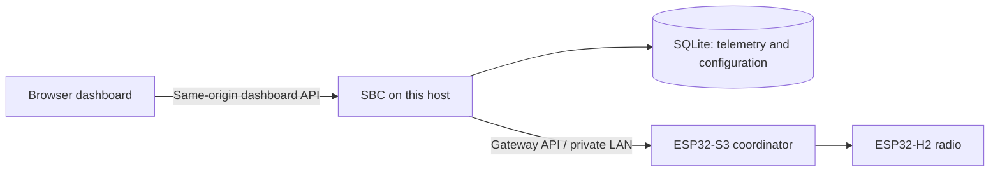

# Dashboard API development plan

Status: named locations and device assignments are implemented in v1; broader
configuration is designed for the next phase. Only the v1 routes in
[API.md](API.md) and the exported OpenAPI documents are implemented today.
The `/api/v2` routes below are reserved proposals, not available endpoints.

## Deployment and ownership

This Linux host is the SBC and application server. It serves the browser assets,
application API and SQLite store. The ESP32-S3 provides the coordinator API and
communicates with the H2 radio. One configured coordinator is supported initially.



| Owner | Data and responsibilities |
| --- | --- |
| ESP32 | Network formation, join window, IEEE/NWK registry, discovery, ZCL requests and raw events |
| SBC | Gateway credentials, polling, normalization, history, device names/locations, layouts, command records and configuration revisions |
| Browser | Presentation, edit drafts and authenticated API requests |

Browser code never receives the gateway bearer token or calls the board directly.
The dashboard bearer token remains in page memory. Serve assets and API from the
same origin; host deployment and remote access follow [SBC_SETUP.md](SBC_SETUP.md).
Gateway connection credentials remain host configuration in the first phase.
Changing the gateway through a browser needs a separate administrative design,
including destination validation and distinguishing historical data by gateway.

## Contract rules

1. The browser consumes the dashboard contract; the SBC consumes the gateway
   contract. Do not expose SDK structures as dashboard dependencies.
2. IEEE is the stable device identity, normalized to lowercase hexadecimal when
   creating new v2 identifiers. A NWK address is a changeable transport address.
3. Endpoint, cluster, attribute and ZCL type IDs are JSON integers. A measurement
   identity is `(ieee, endpoint, cluster, attribute)`.
4. Unix timestamps are seconds in UTC. Keep `received_at` (SBC clock) separate
   from `gateway_uptime_ms`. Do not claim a device observation time from receipt.
5. Configuration is distinct from telemetry. Pairing and polling never overwrite
   a device's user name or location. Never replace confirmed state with a requested state.
6. Major breaking changes use `/api/v2`; existing `/api/v1` remains functional
   during migration. Additive response fields are allowed. Clients tolerate
   unknown fields and event types; request bodies reject unknown fields.
7. Capabilities describe implemented service features, not device reachability.
   Enable device controls only when the gateway is connected/ready and discovery
   shows the appropriate server cluster on the selected endpoint. Incomplete
   discovery is shown explicitly, with advanced manual reads kept separate.

## Proposed resources

All v2 routes require the dashboard bearer token. Responses use JSON and
`Cache-Control: no-store`. Static assets contain no private state.

| Method and route | Purpose |
| --- | --- |
| GET `/api/v2/capabilities` | API version, available features, widget types, operation and query limits |
| GET `/api/v2/gateway` | Connection/readiness, network diagnostics, pairing and ingestion health |
| GET `/api/v2/devices` | Device identities, discovered capabilities, configuration and latest measurements |
| GET `/api/v2/devices/{ieee}` | One device, endpoint map, measurements and freshness |
| GET `/api/v2/configuration` | Whole application configuration plus strong ETag |
| PUT `/api/v2/configuration` | Validate and atomically replace configuration, requiring `If-Match` |
| GET `/api/v2/history` | Bounded, filtered measurement history with opaque page cursor |
| POST `/api/v2/commands` | Persist a request record, dispatch once and return its ID/outcome |
| GET `/api/v2/commands/{id}` | Retrieve dispatch outcome and any supported confirmation evidence |

Ship configuration and device resources first. History queries and command
tracking are subsequent capabilities. Advertise each feature only after its
implementation and tests land. Existing v1 event history is a diagnostic log,
not a chart API.

## Configuration document

Start with one installation-wide configuration shared by all browser sessions.
Multi-user profiles are a later feature; the current bearer token grants access
to the whole installation. Store configuration in a separate SQLite table with
schema version and revision. Keep gateway credentials outside this document.

Example proposed GET result:

```json
{
  "schema_version": 1,
  "revision": 7,
  "locations": [{"id": "1daa7f81-0f10-4c8a-809e-4b4f439e92cf", "name": "Living room"}],
  "devices": {
    "00124b0000000002": {
      "name": "Window sensor",
      "location_id": "1daa7f81-0f10-4c8a-809e-4b4f439e92cf",
      "freshness_seconds": 3600
    }
  },
  "dashboard": {
    "title": "Home",
    "temperature_unit": "celsius",
    "widgets": [{
      "id": "window-temperature",
      "type": "measurement",
      "title": "Window temperature",
      "source": {"ieee": "00124b0000000002", "endpoint": 1, "cluster": 1026, "attribute": 0},
      "position": 0
    }]
  }
}
```

Return `ETag: "configuration-7"`. PUT takes the editable fields `locations`,
`devices` and `dashboard`, with `If-Match: "configuration-7"`. The server owns
`schema_version` and `revision`; reject them in the PUT body. Successful PUT
returns 200 with the complete updated document and new ETag. Missing `If-Match`
returns 428; stale revision returns 412 without changing configuration. The
browser offers reload/reapply after a conflict and does not silently retry.

Initial limits: 64 KiB request body, 50 locations, 50 device overrides, 100 widgets;
names/titles 1–80 characters; widget IDs 1–64 lowercase letters/digits/hyphens,
starting with a letter; location IDs remain the server-generated UUIDs from v1;
freshness 60–604800 seconds, default 3600. Location IDs and widget IDs
are unique, widget positions are distinct integers 0–99, and location references
must exist or be null. Device overrides must reference known IEEE identities.
Omitted device overrides fall back to model/IEEE and no location. Omitted widgets
are deleted on successful full replacement. Removing a location requires clearing
or moving all of its assignments in the same transaction. Widgets initially support
`measurement` and `on_off`; their source must match a discovered compatible
attribute/cluster. `on_off` uses attribute 0 on input cluster 6. Do not accept
HTML, JavaScript, arbitrary URLs or expressions in widget configuration.

Retain names, location assignment and widgets when a known device leaves. A widget
for a departed or unavailable source displays unavailable and disables controls.
Persist before replying; failed validation leaves the previous revision intact.
Use a SQLite transaction for revision comparison and replacement. Once v2
ships, v1 location mutations must also advance that revision to prevent edits
through either API from silently overwriting changes through the other. Configuration
export contains no secrets, and imports go through the same validation path.

## Device and measurement presentation

The proposed v2 device representation uses named fields and arrays rather than
requiring browser code to parse the v1 `endpoint:cluster:attribute` map keys:

```json
{
  "ieee": "00124b0000000002",
  "name": "Window sensor",
  "location_id": "1daa7f81-0f10-4c8a-809e-4b4f439e92cf",
  "registered": true,
  "discovery": "complete",
  "last_received_at": 1791800000.0,
  "measurements": [{
    "endpoint": 1, "cluster": 1026, "attribute": 0,
    "data_type": 41, "raw": 2050,
    "value": 20.5, "unit": "celsius",
    "received_at": 1791800000.0,
    "quality": "stale"
  }]
}
```

`discovery` is `unknown`, `partial`, `complete` or `failed`; do not infer complete
from one endpoint event. Firmware must expose an active-endpoint inventory or
discovery completion evidence before claiming complete. Until then use partial.
Measurement `quality` is `valid`, `invalid` or `stale`. Invalid/missing supported
values have null `value`; stale values retain their last value and timestamp.
Unknown ZCL types remain in raw diagnostics. Compute staleness from the configured
freshness window and receipt age, independently of gateway connectivity. Show
gateway offline separately. Canonical storage units are celsius, percent and
boolean; display-unit changes never rewrite stored measurements.

## History and refresh

History query parameters are `ieee`, `endpoint`, `cluster`, `attribute`, `from`,
`to`, `limit` and optional opaque `cursor`. Require all four measurement identity
fields, `from < to`, at most 31 days per request, and limit 1–500 (default 100).
Sort by SBC receipt time then stable database ID; return `items` and
`next_cursor` (null at end). A cursor binds to the original filter and time range;
reject mismatches. Chart series preserve null invalid values and indicate known
ingestion gaps; aggregation is a later capability with explicitly defined buckets.

Start with periodic GET refresh, no faster than once per three seconds per
browser. Cancel stale requests on disconnect, prevent overlapping polls, and
back off on failures. Configuration refresh is separate from live telemetry.
Future streaming uses an SBC sequence independent of the board's volatile ring,
with authenticated fetch and resynchronization after cursor expiry. Native
EventSource does not carry the current bearer header, so do not put tokens in URLs.

## Command lifecycle

Keep the existing four operation payloads initially. V2 adds a client-generated
UUID `request_id` and a server-generated command ID, with durable records on the
SBC. Command records contain request, creation time, outcome and sanitized error.
Do not automatically replay commands after an outage or restart.

Proposed states are `dispatching`, `accepted`, `rejected`, `unknown`, and (only
with supported correlation) `confirmed`. Acceptance means the Zigbee stack
accepted a request. Unknown means transport failure or an SBC crash leaves
execution uncertain. Do not classify an arbitrary later attribute report as
confirmation of a particular command. Firmware transaction correlation remains
a prerequisite for command-specific confirmation.

Persist and claim a `request_id` before dispatch under a uniqueness constraint.
A duplicate with the identical canonical payload returns the existing record;
a duplicate with a different payload returns 409. Canonicalize IEEE and compare
parsed fields, not raw JSON formatting. Persist final state before responding.
On restart mark abandoned `dispatching` records `unknown` and never redispatch.
Retain request identities for 30 days and publish that deduplication window;
clients must not reuse expired IDs. This avoids duplicate SBC dispatch within
the window; it cannot guarantee exactly-once RF execution.

202 carries an accepted record and `Location` for its GET resource. A request
whose execution is uncertain returns 502 with its command ID and `unknown`
outcome, allowing inspection without retrying. Invalid requests return 400/422;
unavailable gateway returns 503 without dispatch; board rejection is recorded
as rejected. Actuator controls continue to display reported state while showing
the requested operation separately.

## Errors and compatibility

Use a structured v2 error envelope:

```json
{"error":{"code":"configuration_conflict","message":"Configuration changed. Reload before saving.","details":[]},"request_id":"server-request-id"}
```

Stable codes drive browser behavior; messages are display text. Validation
details use `{path, code, message}`. Never include bearer tokens, credentials,
raw upstream URLs or tracebacks. Define 400 malformed JSON/query, 401
unauthenticated, 404 unknown resource, 409 duplicate request conflict, 412 stale
configuration, 413 body too large, 422 semantic validation, 428 missing revision,
502 upstream uncertainty and 503 gateway unavailable. Existing v1 errors remain
`{"error":"message"}`; firmware v1 can return non-JSON HTTP errors.

## Delivery sequence and acceptance

1. Current foundation: both implemented contracts, authenticated SBC capabilities,
   named location CRUD, durable device assignments, grouping in the browser,
   and HTTP/schema validation. These features ship in v1.
2. Implement v2 configuration storage, revision checks, migrations and device
   views. Verify persistence across restart and conflict handling between two
   clients. Keep the existing dashboard working during migration.
3. Build browser location/device editors and configurable widgets against v2. Verify
   empty setup, unknown devices, invalid reports, stale readings, offline state,
   keyboard access and save conflicts. Add browser tests for logout during a poll.
4. Add paginated measurement history and charts with invalid values/gap handling.
5. Add durable command records and firmware-backed correlation where supported.

Configuration, widget and history changes require simulator/SBC and browser
validation. ESP32 protocol changes additionally require firmware build checks
and hardware pairing/control evidence. Do not advertise unavailable capability
flags based only on a roadmap entry.
