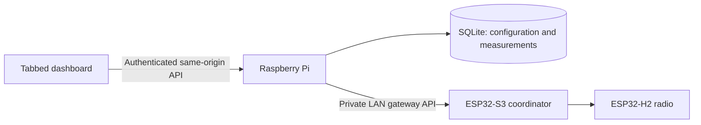

# Dashboard architecture and development plan

Issue #8 implements the location dashboard, configuration and history milestone.
The exact implemented contracts are [API.md](API.md),
[dashboard v1](api/dashboard-v1.openapi.json) and
[dashboard v2](api/dashboard-v2.openapi.json). General-purpose command tracking and streaming below are historical proposals, not available endpoints. Subsequent bounded sensor/display/plug jobs already provide operation-specific acknowledgements and readback; see [S60ZBTPG operation](S60ZBTPG.md) and the current generated contracts.

## Deployment and ownership

The Raspberry Pi hosts the browser assets, application API, SQLite database and
firmware development tools. ESP32-S3 runs the coordinator API and communicates
with the ESP32-H2 radio over UART. One configured coordinator is supported.



The browser never receives gateway credentials. Its dashboard bearer token is
held in page memory; disconnect clears it and aborts requests. Connection secrets
remain host configuration. Browser-based gateway credential management requires
a separate administrative design, including destination validation and keeping
histories separate when switching coordinators.

## Tabs and widgets

Configuration & Setup provides gateway status, pairing, discovery, device
inventory, location CRUD, assignments, names, freshness and display preferences.
One tab is generated per durable location UUID; a rename changes its label.
Unassigned devices remain accessible in Setup. An empty location offers setup
guidance instead of fabricated data.

Each location renders configurable numeric and chart widgets for its assigned
devices. Sources use `(ieee, endpoint, cluster, attribute)`; an endpoint or NWK
address alone is insufficient identity. The editor presents device names,
endpoint numbers and measurement labels. Temperature, humidity and reported
On/Off state are supported initially. Different endpoints/attributes remain
independently selectable. A widget follows its device's current location; moving
or temporarily losing the device does not discard its layout/history.

Numeric widgets display the latest received value, unit and receipt age. They do
not request a radio read. Charts use indexed stored measurements with selectable
hour, six-hour, day, week and thirty-day ranges. Titles, types, source selection,
order and ranges persist. Mouse and keyboard inspection shows timestamps/values.
Location tabs align left in an independently scrollable group, with Configuration
& Setup aligned right. After connection, the first location in the server-provided
order is selected; Setup is the fallback only for an empty location list. Manual
Setup selection survives refresh, renames preserve selection by ID, and deleting
the active location selects the first remaining location. Login/logout retains
no preferred-location or token value in browser persistent storage.
Tab navigation supports arrows, Home and End in location-then-Setup order, with
selected/focused tab semantics.

On first migration, assigned supported endpoint measurements receive initial
numeric/chart pairs, within the 100-widget limit. This runs once: deleting widgets
is respected on restart. Newly assigned devices can use Add sensor widgets or
the individual editor. Layout edits never overwrite telemetry.

## Implemented API resources

All v2 routes require the dashboard bearer token and return no-store JSON.

| Method and route | Purpose |
| --- | --- |
| GET `/api/v2/capabilities` | Actual widget types, features and limits |
| GET `/api/v2/gateway` | Gateway readiness/connectivity and ingestion status |
| GET `/api/v2/devices` | Named devices and endpoint measurement views |
| GET `/api/v2/configuration` | Installation-wide configuration and strong ETag |
| PUT `/api/v2/configuration` | Validated atomic replacement, requiring If-Match |
| GET `/api/v2/history` | Bounded, filtered, paginated measurement history |
| GET `/api/v2/openapi.json` | Exported implemented contract |

V1 remains functional: commands and location CRUD continue through it. V1
location/assignment mutations advance the same configuration revision. A new
device changes the configuration revision because GET includes its default
settings; ordinary telemetry does not. Capability flags remain false for
unimplemented command tracking and streaming.

## Configuration and concurrency

Configuration uses separate tables from telemetry. GET returns server-owned
schema version/revision plus editable locations, devices and dashboard. PUT takes
only those editable fields and `If-Match: "configuration-N"`. Missing revision
returns 428; stale revision 412 without changing data. A SQLite immediate
transaction protects the revision comparison and replacement across writers.

The browser preserves focused drafts while polling. On a conflict it offers
Reload configuration or Reload & reapply edit. Reapplication is an explicit user
action and applies the particular edit to the latest document, preserving other
sessions' unrelated changes. It does not silently resubmit an outdated document.

Limits: 64 KiB body, 50 locations, 50 device settings, 100 widgets; names/titles
1–80 visible single-line characters. Location IDs come from server-generated v1
locations. Device settings reference known IEEE identities, optional friendly
name, nullable location and freshness 60–604800 seconds (default 3600).
Widget IDs are unique lowercase letters/digits/hyphens, start with a letter, and
have at most 64 characters. Positions are unique integers 0–99.

Example widget:

```json
{
  "id": "garage-temperature-history",
  "type": "chart",
  "title": "Temperature history",
  "source": {"ieee": "00124b0000000002", "endpoint": 1, "cluster": 1026, "attribute": 0},
  "position": 1,
  "time_range": 86400
}
```

Types are `numeric` and `chart`; both save a time range for switching their type.
Supported, discovered/observed sources are validated. Arbitrary widget code,
URLs or expressions are not executable configuration. Text is rendered with DOM
text nodes. Display units are Celsius or Fahrenheit; conversion does not modify
stored Celsius measurements. No gateway secrets are included in configuration.

## Measurements, history and refresh

Views expose labelled measurements with quality `valid`, `invalid`, `missing` or
`stale`. Null/invalid samples do not become zero. Stale values retain their last
value and receipt timestamp. Gateway connectivity is separate from freshness;
registered does not prove current reachability. Discovery remains partial when
endpoint descriptions exist: complete discovery needs firmware evidence of all
active endpoints, rather than inference from a single response.

History uses SBC receipt timestamps, not inferred device observation times.
Existing retained attribute events are backfilled once, preserving their receipt
times and deduplicating by boot/sequence. New measurements are stored with events
and cursor in the same ingestion transaction. Canonical values are Celsius,
percent and Boolean state; unknown ZCL types remain diagnostic raw events.

Queries require IEEE/endpoint/cluster/attribute and UTC Unix `from`/`to` seconds,
span at most 31 days, and allow pages of 1–500 samples. Sort is receipt time then
stable database ID. A signed opaque cursor binds to the original filter/range
and survives service restart. Tampered/mismatched cursors return 400.

Known connection interruptions, coordinator restarts and ring gaps have stored
markers when prior ingestion evidence exists. Charts break at these markers,
invalid samples and intervals longer than the device freshness window. They do
not imply that every radio loss is detected. Marker results are limited to 500;
an explicit truncation flag prevents connecting points across undisplayed gaps.
Normal history retention remains thirty days.

Browser telemetry/configuration refreshes every three seconds, with no overlapping
refreshes and ten-second backoff after failures. Focused drafts are not replaced.
Only charts in the active location fetch history. Cache lifetime is thirty seconds
unless a new latest measurement is received. At most 20 pages/10,000 readings are
drained per chart; a visible limit notice asks for a shorter range. Disconnect,
logout and tab changes cancel stale chart work.

## Validation and next phases

The milestone requires simulator/SBC integration, actual response schema checks,
database migration/restart tests, concurrent edit tests and Chromium interaction
checks. Browser coverage includes location lifecycle, multiple endpoints,
widgets/types/order/ranges, empty setup, stale/invalid/offline data, keyboard/mobile
use and logout during pending telemetry/history requests. Changes to the ESP32
protocol still require firmware builds and hardware evidence separately.

Future work includes bucketed history aggregation for dense long-range charts,
additional normalized measurement types, completed-discovery evidence and
device-specific firmware reporting configuration.

## Future command tracking and streaming

No `/api/v2/commands` routes are implemented in this milestone. A future design
adds client UUID request identities and durable command IDs on the SBC. Claim an
identity before dispatch under a uniqueness constraint; identical retries return
the saved result, while changed payloads conflict. Do not replay commands after
outage/restart. Abandoned dispatching records become unknown. Retain request
identities for thirty days and publish that deduplication window.

Stack acceptance is not RF delivery or device-state confirmation. Only supported
firmware transaction correlation may confirm a specific command; arbitrary later
attribute reports cannot. Keep requested operations separate from reported state.
This can prevent duplicate SBC dispatch within the retention window, not promise
exactly-once RF execution. Future streaming needs an authenticated SBC sequence
and resynchronization after expiry; never put bearer tokens in event URLs.
